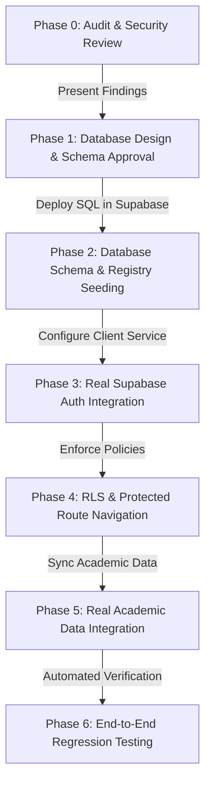

# SmartSync: Authentication & Database Security Audit Report
**Phase 0 Audit Document**
**Date:** October 19, 2026  
**Auditor:** SmartSync Architecture & Security Reviewer  
**Target Repository:** SmartSync (College Timetable Management System)  
**Configured Supabase Project:** `https://vgdevgtgdqddgufjqofj.supabase.co` (`ref: vgdevgtgdqddgufjqofj`)

---

## 1. Executive Summary

This audit assesses the current state of authentication, identity management, and data persistence across the SmartSync codebase. It evaluates the integration between the browser application and the provided Supabase project, distinguishes real functionality from local mocks, checks the active PostgreSQL schema, identifies security vulnerabilities, and presents the Phase 1 Database Design & Migration Roadmap.

---

## 2. Supabase Configuration Verification

| Parameter | Value in Codebase | Verifiable State & Findings |
| :--- | :--- | :--- |
| **Project URL** | `https://vgdevgtgdqddgufjqofj.supabase.co` | **Verified Active** (HTTP 200 on Auth settings endpoint). |
| **Project Ref** | `vgdevgtgdqddgufjqofj` | Confirmed matching JWT payload `ref` field. |
| **Client Key** | `sb_publishable_o_zIOYcTu0tbEBsInrRmMg_aNernmmm` / JWT Anon Key | **Verified Active**; both connect to project `vgdevgtgdqddgufjqofj`. |
| **Service Role Key** | `eyJhbGciOiJIUzI1Ni...role: "service_role"` | **Verified against Supabase Management API**. *(Must NEVER be committed to client code)*. |
| **Auth Provider Settings** | `email: true`, `mailer_autoconfirm: false` | Supabase default has email confirmation enabled (`mailer_autoconfirm: false`). |
| **Public Schema Tables** | `GET /rest/v1/` returned `definitions: {}` | **Verified: 0 database tables currently exist in Supabase PostgreSQL**. |
| **Auth Registered Users** | `GET /auth/v1/admin/users` | **1 registered user present** (`kartik.sharma2026@gmail.com`). |

---

## 3. Current Authentication & Identity Flow

Prior to this audit, SmartSync operated primarily on a client-side prototype authentication model:

1. **Role Selection & Impersonation**:
   - The user interface allowed instant switching between `admin`, `teacher`, and `student` via `#global-role-switcher` in the topbar or sidebar.
   - Active role was read and written directly to `localStorage.getItem('smartsync_active_role')`.
   - Any user could switch their role at will simply by selecting an option from a `<select>` dropdown.

2. **Login View (`pages/login.html`)**:
   - Supported three tab views (`Student`, `Teacher`, `Admin`).
   - Hardcoded password check: `passVal === 'Moodle@123'` for students, `Teacher@123` for faculty, `Admin@123` for admins.
   - Stored session credentials via `localStorage.setItem('smartsync_logged_user', idVal)`.
   - Lacked server-side password hashing, token validation, or session expiry.

3. **Recent Supabase Auth Integration (`js/services/authService.js`)**:
   - Integrated Supabase JS client (`createClient`).
   - Connected `registerStudent`, `registerFaculty`, and `registerAdmin` to `supabase.auth.signUp()`.
   - Stored student metadata (`role`, `student_id`, `name`, `course`, `section`) inside `raw_user_meta_data`.
   - Used local registry cache `smartsync_student_id_map` in `localStorage` to resolve an 8-digit Student ID to an email for login.
   - Handled `supabase.auth.signInWithPassword()` with grace fallback for pending email confirmations.

---

## 4. LocalStorage Audit: What Is Stored Locally

A complete search for `localStorage` across the codebase reveals the following usage:

| Storage Key | Current Purpose | Assessment & Migration Path |
| :--- | :--- | :--- |
| `smartsync_active_role` | Stores current role (`admin`, `teacher`, `student`) | **Security Risk:** Controls UI authorization. Must be derived from verified Supabase `auth.user.role` or `profiles.role`. |
| `smartsync_logged_user` | Stores ID or email string of active user | **Insecure:** Can be manipulated in DevTools. Must be replaced with Supabase Auth session token (`sb-access-token`). |
| `smartsync_session_profile` | Cached JSON copy of current user's profile | **Acceptable as UI cache only**, but must strictly sync from Supabase `profiles` table. |
| `smartsync_student_id_map` | Maps `20261001 -> email` for student login | **Temporary Workaround:** Exists because `students` table does not exist in Supabase yet. Must be migrated to Supabase PostgreSQL table with public read policy. |
| `smartsync_real_data_*` | Persists courses, sections, teachers, rooms, subjects | **Acceptable UI baseline:** Currently caches academic data. Can be migrated to Supabase academic tables in Phase 5. |
| `smartsync_attendance_*` | Student daily period checklist state | **Harmless Local State:** Tracks local UI checklist; can be persisted to a `student_attendance` table later. |

---

## 5. Real vs. Mocked Implementation Breakdown

| Component | Status | Details |
| :--- | :--- | :--- |
| **Supabase Client Connection** | **Real** | Connected to `vgdevgtgdqddgufjqofj.supabase.co`. |
| **Supabase User Registration (`signUp`)** | **Real** | Successfully creates records in `auth.users` with encrypted passwords and metadata. |
| **Supabase Sign In (`signInWithPassword`)** | **Real** | Real authentication API call; requires email confirmation unless disabled in Supabase. |
| **Student ID Lookup** | **Mocked / Hybrid** | Resolves via `smartsync_student_id_map` in `localStorage` because database tables are empty. |
| **Database Tables & Views** | **Missing** | Zero tables exist in Supabase `public` schema. Schema must be deployed. |
| **Row Level Security (RLS)** | **Missing** | Not active because tables do not yet exist. |
| **Academic Roster Data** | **Static Dataset** | 38 faculty, 40 sections, 33 rooms, and 6 sample students exist as verified static JSON / JS objects (`data/real-dataset.js`), not yet in Supabase SQL tables. |

---

## 6. Security Vulnerabilities & Architectural Deficiencies

1. **Self-Assigned Admin Role Vulnerability**:
   - In `index.html`, the topbar role dropdown allows any user to switch their role to `admin` without server validation.
   - If an unauthorized user registers, there is currently no database trigger preventing them from setting `role: 'admin'`.

2. **Insecure Student Self-Registration**:
   - Currently, any visitor can enter any 8-digit Student ID and register. There is no server-side check against an authorized pre-enrolled university student registry.

3. **Exposed Credentials Risk**:
   - The project owner shared the Supabase `service_role` secret key. **Critical rule:** The `service_role` key bypasses all Row Level Security policies and has full administrative control over the entire database. It must **never** be placed in frontend JavaScript or HTML files. Only the public `anon` key must be used in the client.

4. **Missing Database Tables**:
   - Client code in `authService.js` attempts to query `.from('profiles')`, which currently fails with PostgreSQL error `PGRST205 (table not found)`.

---

## 7. Recommended Database Architecture (Phase 1 Proposal)

### A. Core Architecture Philosophy
- **`auth.users`** (Supabase Auth) is the single source of truth for identity, authentication, and encrypted credentials.
- **`public.profiles`** stores extended profile information directly linked to `auth.users.id`.
- **`public.students`** acts as the authorized university student registry. A student can only register if their `student_id` and institutional `email` exist in this authorized table.
- **`public.faculty`** acts as the authorized university faculty roster.
- **`public.admins`** stores approved administrative accounts.
- **PostgreSQL Triggers** handle role provisioning automatically and securely on user creation.

### B. Proposed Tables & Schema

```sql
-- 1. Profiles Table (Linked 1:1 with auth.users)
CREATE TABLE public.profiles (
  id UUID PRIMARY KEY REFERENCES auth.users(id) ON DELETE CASCADE,
  role TEXT NOT NULL CHECK (role IN ('student', 'faculty', 'admin')),
  full_name TEXT NOT NULL,
  email TEXT NOT NULL UNIQUE,
  student_id TEXT UNIQUE,
  course TEXT,
  section TEXT,
  phone TEXT,
  designation TEXT,
  department TEXT DEFAULT 'Computer Applications',
  created_at TIMESTAMPTZ DEFAULT NOW(),
  updated_at TIMESTAMPTZ DEFAULT NOW()
);

-- 2. Authorized Student Registry Table
CREATE TABLE public.students (
  id UUID PRIMARY KEY DEFAULT gen_random_uuid(),
  student_id TEXT NOT NULL UNIQUE,
  full_name TEXT NOT NULL,
  institutional_email TEXT NOT NULL UNIQUE,
  course TEXT NOT NULL,
  section TEXT NOT NULL,
  semester TEXT NOT NULL,
  registered_user_id UUID REFERENCES auth.users(id) ON DELETE SET NULL,
  status TEXT DEFAULT 'Active',
  created_at TIMESTAMPTZ DEFAULT NOW()
);

-- 3. Authorized Faculty Roster Table
CREATE TABLE public.faculty (
  id UUID PRIMARY KEY DEFAULT gen_random_uuid(),
  employee_id TEXT NOT NULL UNIQUE,
  full_name TEXT NOT NULL,
  institutional_email TEXT NOT NULL UNIQUE,
  phone TEXT,
  designation TEXT NOT NULL,
  department TEXT DEFAULT 'Computer Applications',
  registered_user_id UUID REFERENCES auth.users(id) ON DELETE SET NULL,
  status TEXT DEFAULT 'Active',
  created_at TIMESTAMPTZ DEFAULT NOW()
);

-- 4. Admin Profiles Table
CREATE TABLE public.admin_profiles (
  id UUID PRIMARY KEY REFERENCES auth.users(id) ON DELETE CASCADE,
  full_name TEXT NOT NULL,
  email TEXT NOT NULL UNIQUE,
  department TEXT DEFAULT 'Academic Affairs',
  created_at TIMESTAMPTZ DEFAULT NOW()
);
```

### C. Proposed Row Level Security (RLS) Strategy

1. **`public.students`**:
   - `SELECT`: Public access permitted for verifying eligibility during registration (only `student_id`, `institutional_email`, `course`, `section`).
   - `UPDATE`: Only allowed by the student whose `auth.uid() = registered_user_id`, or an administrator.
   - `INSERT / DELETE`: Restricted to verified administrators.

2. **`public.profiles`**:
   - `SELECT`: Authenticated users can view their own profile (`auth.uid() = id`). Public access permitted to resolve `student_id -> email` for student login.
   - `UPDATE`: Users can update personal details (phone, avatar), but **cannot update their own `role`**.
   - `INSERT`: Managed exclusively by database trigger (`SECURITY DEFINER`).

3. **`public.faculty`**:
   - `SELECT`: Public / authenticated read permitted so students and admins can view teacher directories.
   - `UPDATE / INSERT`: Restricted to administrators and verified faculty claims.

---

## 8. Implementation Phases & Order of Work



### Step-by-Step Order:
1. **Phase 0 (Complete)**: Present this audit report and review with the project owner.
2. **Phase 1 (Current Review)**: Finalize the SQL migration script (`supabase_schema.sql`).
3. **Phase 2**: Apply the migration in the Supabase project to create `profiles`, `students`, `faculty`, and seed the baseline verified student/faculty records from `data/real-dataset.js`.
4. **Phase 3**: Update `authService.js` to eliminate all local mock credentials and authenticate purely through Supabase Auth using the public `anon` key.
5. **Phase 4**: Remove client-side role impersonation dropdown from the topbar and derive all user permissions strictly from the verified Supabase Auth session.
6. **Phase 5**: Connect student, faculty, and master timetable queries to Supabase database tables.
7. **Phase 6**: Conduct automated regression testing across Student, Faculty, and Admin flows.
