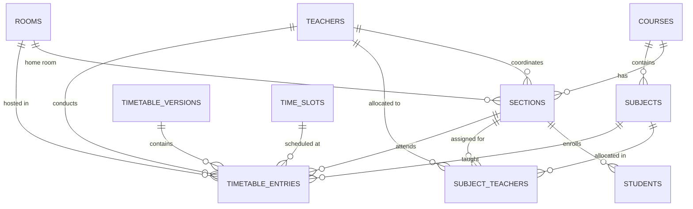

# 🎓 SmartSync - AI-Powered College Timetable Management System

> **Architecture Specification & Roadmap Locked**  
> **Date:** 18/10/26  
> **Institution Context:** Graphic Era Hill University (Department of Computer Applications)

---

## 📌 Executive Summary

**SmartSync** is an automated, AI-augmented academic scheduling and timetable management system designed for **Administrators**, **Faculty**, and **Students**. It tackles the NP-hard combinatorial problem of academic scheduling by balancing hard resource constraints (preventing double-booking of teachers, rooms, and sections) and optimizing soft constraints (balanced faculty daily workloads, minimized student gaps, and optimal lab session scheduling).

---

## 🏛️ System Architecture: The 4-Pillar Stack

```
                  ┌────────────────────────────────────────────────────────┐
                  │       Frontend UI: JavaScript / HTML5 / CSS3           │
                  │   Admin Dashboard │ Teacher Portal │ Student Portal    │
                  └───────────────────────────┬────────────────────────────┘
                                              │ HTTP REST / SSE / WebSockets
                                              ▼
┌──────────────────────────────────────────────────────────────────────────────────────────────┐
│                              MAIN APPLICATION: Java + Spring Boot                            │
│  ├── Authentication & RBAC (Admin / Faculty / Student)                                      │
│  ├── Academic Entities Management (Courses, Sections, Teachers, Rooms, Labs, Subjects)       │
│  ├── Master Timetable Management & Versioning                                                │
│  ├── Core Scheduling Engine (Constraint Satisfaction + Genetic Algorithm in Java)           │
│  │   └── Validates: Teacher Free? ➔ Room Free? ➔ Section Free? ➔ No Clash? ➔ Balanced Gaps?   │
│  ├── Conflict Detection Engine & Differential Notifications ("Moved from Room 204 to 301")   │
│  └── Caching & Event Gateway (Redis / WebSocket Push)                                        │
└───────────────────────────┬──────────────────────────────────┬───────────────────────────────┘
                            │                                  │
                 JPA / JDBC │                                  │ REST API (JSON)
                            ▼                                  ▼
               ┌────────────────────────┐         ┌────────────────────────────────────────┐
               │    DATABASE: MySQL     │         │       AI/ML BRAIN: Python + FastAPI    │
               │  - Normalized 10 Tables │         │  - Machine Learning (Scikit-learn)     │
               │  - Enforces Constraints │         │  - Pattern Analysis & Historical Logs  │
               │  - Viva-friendly & solid│         │  - Schedule Stability Score (e.g. 91%) │
               └────────────────────────┘         │  - Change Risk Prediction              │
                                                  └────────────────────────────────────────┘
```

### Why This Stack? (Viva & Academic Defense)
- **Java (Spring Boot) = Main Application**: Robust enterprise backbone handling business logic, data validation, role-based access control (RBAC), REST APIs, and native execution of the core Genetic Algorithm / Constraint Solver.
- **Python (FastAPI + Scikit-learn) = AI/ML Brain**: Dedicated intelligence service focusing on historical pattern analysis and predictive metrics rather than rule checking.
- **MySQL = Data Storage**: Industry-standard, relational, 3NF-normalized storage with database-level unique constraints, easy to defend during evaluations.
- **JavaScript / HTML5 / Vanilla CSS3 = User Interface**: Clean, accessible, and responsive client without heavy frontend framework bloat.

---

## 🛠️ Tools & Technologies Used

| Layer | Technology | Primary Responsibilities |
|---|---|---|
| **User Interface** | **HTML5, Vanilla CSS3, JavaScript (ES6+), Bootstrap 5** | Semantic markup, custom CSS design tokens, responsive grid, dynamic view routing, modal dialogues. |
| **Icons & Typography** | **Lucide Icons, Plus Jakarta Sans** | Modern visual cues and typography. |
| **Main Backend** | **Java + Spring Boot 3.x** | User authentication, RBAC, REST APIs, timetable entity management, notification service. |
| **Scheduling Engine** | **Java (Constraint Optimization + Genetic Algorithm)** | Validates teacher availability, room availability, section availability, lab continuity (2 slots), and gap optimization. |
| **Database** | **MySQL** | Storage of all 10 core academic and scheduling tables with relational integrity. |
| **AI/ML Service** | **Python, FastAPI, Scikit-learn** | Schedule stability scoring, modification risk prediction, and historical pattern analysis. |
| **Caching & Real-Time** | **Redis, WebSockets / Server-Sent Events (SSE)** | Caching active timetables and pushing live schedule updates to browsers without refresh. |
| **Infrastructure & DevOps**| **Git, GitHub, Docker, GitHub Actions** | Version control, containerization, and continuous integration. |

---

## 🗄️ Database Architecture (The 10 Core Tables in MySQL)

The system is structured around **10 normalized tables** organized into 4 logical tiers:



1. **`courses`**: Degree programs (`id`, `code`, `name`, `degree_level`, `duration_years`, `description`).
2. **`sections`**: Class groups (`id`, `name`, `course_id`, `semester`, `coordinator_id`, `home_room_id`).
3. **`teachers`**: Faculty members (`id`, `employee_code`, `name`, `email`, `phone`, `department`, `designation`, `max_weekly_hours`).
4. **`rooms`**: Facilities (`id`, `code`, `room_type` [Lecture Hall / Lab], `capacity`, `building`, `floor`).
5. **`subjects`**: Curriculum syllabus (`id`, `code`, `name`, `course_id`, `semester`, `type` [Theory / Lab], `credit_hours`, `periods_per_week`).
6. **`subject_teachers`**: Faculty-to-subject-to-section allocation matrix.
7. **`time_slots`**: Daily master periods (`id`, `day_of_week`, `period_number`, `start_time`, `end_time`, `is_break`).
8. **`timetable_versions`**: Schedule snapshot and lifecycle management (`id`, `version_number`, `academic_term`, `status` [Draft / Published / Archived]).
9. **`timetable_entries`**: Master schedule entries with database-level uniqueness constraints:
   - `UNIQUE(teacher_id, time_slot_id, version_id)` ➔ Prevents teacher double-booking.
   - `UNIQUE(room_id, time_slot_id, version_id)` ➔ Prevents room double-booking.
   - `UNIQUE(section_id, time_slot_id, version_id)` ➔ Prevents section clashes.
10. **`students`**: Student registry (`id`, `student_id_number`, `name`, `roll_no`, `section_id`, `email`, `semester`, `status`).
*Optional extension tables*: `conflicts_log` (audit trail) and `substitutions` (faculty leave management).

---

## 🤖 Timetable Generation Engine & AI/ML Brain

### 1. Constraint-Based Scheduling + Genetic Algorithm (Java)
The scheduler operates through a progressive feasibility and fitness loop:
```
Teacher available?
        ↓
Room available?
        ↓
Section available?
        ↓
No subject clash?
        ↓
No teacher clash?
        ↓
No room clash?
        ↓
Gap between classes acceptable?
        ↓
Generate timetable & optimize fitness score
```

### 2. What the Python ML Service Actually Learns
By analyzing historical timetable modifications (changes, clash reports, faculty feedback, and student gap distribution), the ML model:
- Produces a **Schedule Stability Score** (e.g., `Stability Score: 91/100`).
- Predicts **Modification Probability**: Flags high-risk slots likely to require future room/teacher changes before the term begins.

---

## ⚡ Real-Time Updates & Contextual Notifications

- **Redis Caching**: Caches active timetables, session states, and pre-computed schedules for sub-millisecond retrieval.
- **WebSockets / SSE**: Push notifications directly to connected browsers:
  ```
  Admin changes timetable ➔ Backend Event ➔ WebSocket Push ➔ Client UI updates instantly without page refresh
  ```
- **Contextual Diffs**: Notifications explain **what changed**:
  > *"Your BCA-C Data Structures class has been moved from Room 204 to Room 301 on Thursday Period 2."*

---

## 🎯 Expected Outcomes & Future Scope

### Expected Outcomes
- **Faster Timetable Generation**: Automated generation in seconds vs. days of manual coordination.
- **Zero Hard Conflicts**: Guaranteed elimination of room, teacher, and section double-bookings.
- **Reduced Student Gaps**: Optimized distribution of lectures across the week.
- **High Resource Utilization**: Maximize usage of specialized lecture halls and 12 computer labs.
- **Immediate Transparency**: Instant, synchronized schedule updates across Admin, Faculty, and Students.

### Future Scope
- Expansion across all university schools and academic departments.
- Examination scheduling and invigilator assignment.
- Automated faculty leave requests and one-click substitution suggestions.
- Student attendance tracking integration.

---

## 📊 Real University Dataset Overview (Graphic Era Hill University)

- **Degree Programs**: 4 Courses (`BCA`, `MCA`, `B.Sc IT`, `B.Sc CS`)
- **Active Class Sections**: 40 Sections (BCA I, III, V; MCA I, III; B.Sc IT/CS)
- **Faculty Roster**: 38 Unique Faculty Members (with departments, phone numbers, and emails)
- **Rooms & Facilities**: 33 Rooms (21 Lecture Halls & 12 Computer Labs)
- **Extracted Source Documents**: Official PDF timetables and Class Coordinator lists stored in `Courses details/`.

---

## 📂 Current Project Directory Layout

```
d:\Timewise - pbl\
├── index.html                   # Main single-page application shell
├── README.md                    # System architecture specification (18/10/26)
├── PROJECT_ANALYSIS.md          # Architectural plan & audit log
├── data/
│   ├── real-dataset.js          # Extracted real university dataset (JS window format)
│   ├── courses.json             # Degree programs (BCA, MCA, B.Sc IT, B.Sc CS)
│   ├── sections.json            # 40 Active class sections
│   ├── teachers.json            # 38 Unique faculty members
│   ├── rooms.json               # 33 Rooms & Computer labs (21 Halls, 12 Labs)
│   ├── subjects.json            # Real curriculum subjects
│   └── timetable.json           # Master timetable storage
├── css/
│   ├── variables.css            # Color tokens, typography, radii, shadows
│   ├── base.css                 # CSS resets & core typography
│   ├── layout.css               # Sidebar, Topbar, Main Shell grid
│   ├── components.css           # Stat cards, Buttons, Badges, Modals
│   ├── pages.css                # Hero banners & page styles
│   └── responsive.css           # Breakpoints & mobile drawer overrides
├── js/
│   ├── main.js                  # Global application controller & router
│   ├── navigation.js            # Responsive sidebar & role switching logic
│   ├── utils.js                 # HTML escape, toast notifications, badges
│   ├── views.js                 # Modular views renderer for all pages
│   └── services/
│       └── dataService.js       # Unified async data access layer
├── pages/
│   ├── login.html               # Academic Login Screen
│   ├── admin/dashboard.html     # Admin workspace redirect
│   ├── teacher/dashboard.html   # Faculty workspace redirect
│   └── student/dashboard.html   # Student workspace redirect
└── Courses details/             # Source PDF timetables & CC roster documents
```

---

## 🚀 How to Run the Frontend Locally

1. Open a terminal in the root directory (`d:\Timewise - pbl`).
2. Launch a static web server:
   ```bash
   npm start
   # or
   npx http-server . -p 3000
   ```
3. Open your browser and navigate to:
   - **Main Workspace Shell**: [http://localhost:3000](http://localhost:3000)
   - **Academic Login Screen**: [http://localhost:3000/pages/login.html](http://localhost:3000/pages/login.html)
